# Guía: Servidor web con Nginx en Oracle Cloud y subdominio DuckDNS

**Autor:** JUAN MEDINA Y BRAYAM PRIETO
**Curso:** TI Y CLOUD COMPUTING
**Sitio publicado:** http://cafedealtura.duckdns.org

---

## Objetivo

Crear una máquina virtual en Oracle Cloud Infrastructure (OCI), instalar Nginx, publicar una página web propia (con tres secciones, imágenes, CSS adaptable a móviles y JavaScript) y hacerla accesible mediante un subdominio gratuito de DuckDNS por HTTP.

## Requisitos previos

- Cuenta de Oracle Cloud con un usuario con permisos para crear recursos de cómputo y red.
- Cuenta en [DuckDNS](https://www.duckdns.org).
- Página web lista: `index.html`, `style.css`, `script.js` y carpeta de imágenes.
- Cliente SSH (PowerShell en Windows).

> **Nota:** Se usó un shape marcado como **Always Free-eligible** para no generar costos.

---

## Paso 1. Permisos del usuario (cuenta administradora)

Desde la cuenta administradora se concedieron permisos al usuario que crea el servidor.

### 1.1 Crear el grupo

Menú ☰ → **Identity & Security** → **Domains** → dominio *Default* → **User management** → **Groups** → **Create group**.

| Campo | Valor |
|-------|-------|
| Name | `estudiantes` |
| Description | `Grupo de estudiantes para el trabajo de Nginx y DuckDNS` |
| Users | Marcar el usuario creado en el taller |

Pulsar **Create**.

### 1.2 Crear la política

Menú ☰ → **Identity & Security** → **Policies** → **Create Policy**.

| Campo | Valor |
|-------|-------|
| Name | `politica-estudiantes` |
| Description | `Permisos para crear la VM y la red del trabajo` |
| Compartment | `(root)` (el compartment raíz del tenancy) |
| Policy Builder | Activar **Show manual editor** |

En el editor pegar:

```
Allow group 'Default'/'estudiantes' to manage all-resources in tenancy
```

> Si la consola indica un error con las comillas, usar la versión corta: `Allow group estudiantes to manage all-resources in tenancy`.

Pulsar **Create**.

📸 **Captura 1:** grupo y política creados.

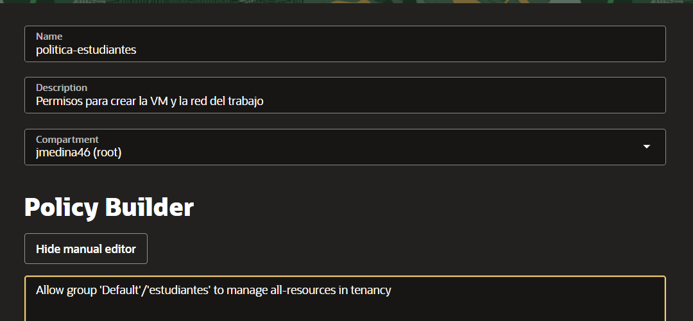

---

## Paso 2. Crear la máquina virtual

1. Iniciar sesión con el usuario nuevo.
2. Ir a **Compute → Instances → Create instance**.
3. Configurar cada sección así:

**Name and compartment**

| Campo | Valor |
|-------|-------|
| Name | `web-nginx` |
| Create in compartment | El compartment que usas normalmente (si no hay otro, `root`) |

**Placement**

| Campo | Valor |
|-------|-------|
| Availability domain | El que aparece por defecto (si da *Out of capacity*, probar otro AD) |
| Capacity type / Fault domain | Dejar por defecto |

**Security**

| Campo | Valor |
|-------|-------|
| Shielded instance | **Desactivado** (por defecto) |
| Confidential computing | **Desactivado** |

**Image and shape**

| Campo | Valor |
|-------|-------|
| Image | **Change image** → **Canonical Ubuntu** → versión **22.04** → *Select image* |
| Shape | **Change shape** → *Virtual machine* → serie **AMD** → `VM.Standard.E2.1.Micro` (debe decir **Always Free-eligible**) → *Select shape* |

**Networking**

| Campo | Valor |
|-------|-------|
| Primary network | **Select existing virtual cloud network** (la VCN del taller inicial) |
| Subnet | **Select existing subnet** → la **subred pública** |
| Public IPv4 address | **Automatically assign public IPv4 address** → **Activado** |
| Assign IPv6 address | **Desactivado** |
| Network security groups | No activar |

**Add SSH keys**

| Campo | Valor |
|-------|-------|
| Opción | **Generate a key pair for me** |
| Acción | Pulsar **Save private key** (descarga el `.key`) y también **Save public key** |

**Boot volume**

| Campo | Valor |
|-------|-------|
| Specify a custom boot volume size | **Desactivado** (se queda en ~47 GB, dentro del nivel gratuito) |
| Use in-transit encryption | **Activado** (por defecto) |
| Encrypt with customer-managed key | **Desactivado** |

**Advanced options** (opcional): dejar todo por defecto, sin cloud-init.

4. Pulsar **Create** y esperar a que el estado sea **Running**.
5. Copiar la **IP pública**.

> Si no existe una VCN del taller, usar **Create new virtual cloud network** con nombre `vcn-web` y **Create new public subnet** con nombre `subred-publica`, dejando los CIDR por defecto.

📸 **Captura 2:** formulario con el shape Always Free seleccionado.

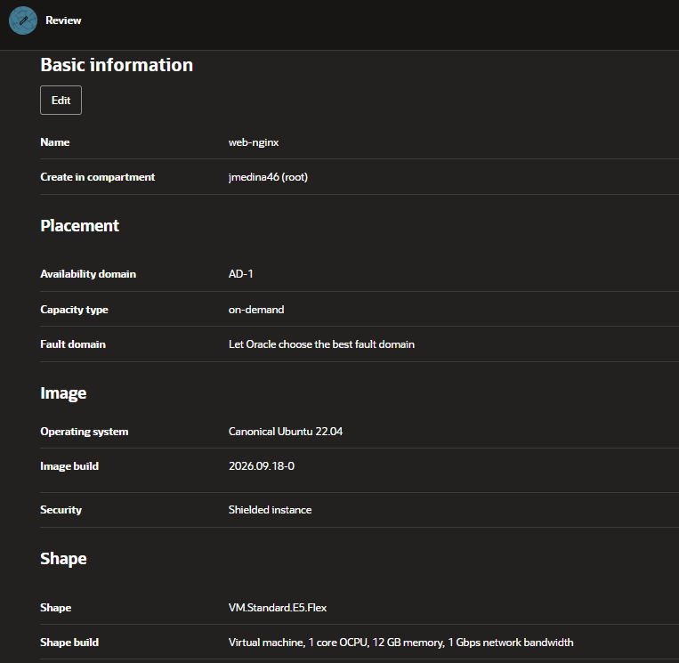

📸 **Captura 3:** instancia en estado *Running* con su IP pública.

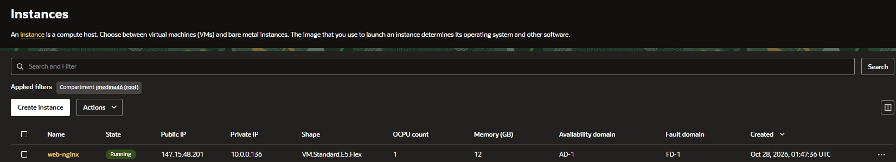

---

## Paso 3. Abrir los puertos 80 y 443 en la red

1. **Networking → Virtual Cloud Networks** → seleccionar la VCN → subred pública → **Security Lists** → lista por defecto.
2. Entrar a la **Default Security List for red-infraestructura** y pulsar **Add Ingress Rules** y crear dos reglas con estos valores:

| Campo | Regla HTTP | Regla HTTPS |
|-------|-----------|-------------|
| Stateless | **Desmarcado** | **Desmarcado** |
| Source Type | `CIDR` | `CIDR` |
| Source CIDR | `0.0.0.0/0` | `0.0.0.0/0` |
| IP Protocol | `TCP` | `TCP` |
| Source Port Range | *(vacío, todos)* | *(vacío, todos)* |
| Destination Port Range | `80` | `443` |
| Description | `HTTP` | `HTTPS` |

Para agregar la segunda regla usar **+ Another Ingress Rule** y luego **Add Ingress Rules**.

📸 **Captura 4:** reglas de entrada agregadas.

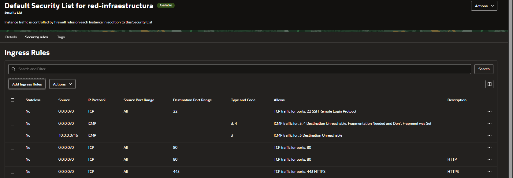

---

## Paso 4. Conexión por SSH

Desde PowerShell, ubicarse en la carpeta donde se descargó la llave privada (en este caso Descargas) y conectarse. Escribir el comando **sin espacios** después de `.\`:

```powershell
cd $HOME\Downloads
```

```powershell
ssh -i .\ssh-key-2026-10-28.key ubuntu@147.15.48.201
```

Si aparece un error de permisos en la llave:

```powershell
icacls .\ssh-key-2026-10-28.key /inheritance:r
icacls .\ssh-key-2026-10-28.key /grant:r "$($env:USERNAME):(R)"
```

📸 **Captura 5:** sesión SSH iniciada en la VM.

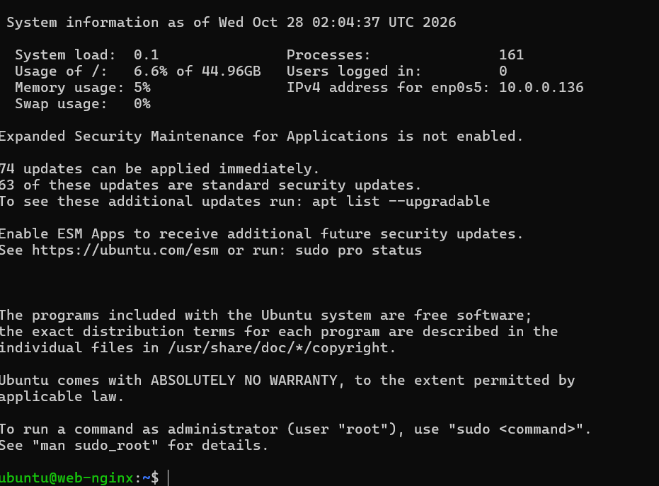

---

## Paso 5. Instalar Nginx

```bash
sudo apt update && sudo apt upgrade -y
sudo apt install nginx -y
sudo systemctl enable --now nginx
systemctl status nginx
```

> Durante la instalación pueden aparecer pantallas moradas (*Pending kernel upgrade* y *Daemons using outdated libraries*). Es normal: presionar **Enter** en `<Ok>`, dejar las casillas vacías y, al terminar, reiniciar con `sudo reboot` y reconectarse.

📸 **Captura 6:** `systemctl status nginx` mostrando *active (running)*.

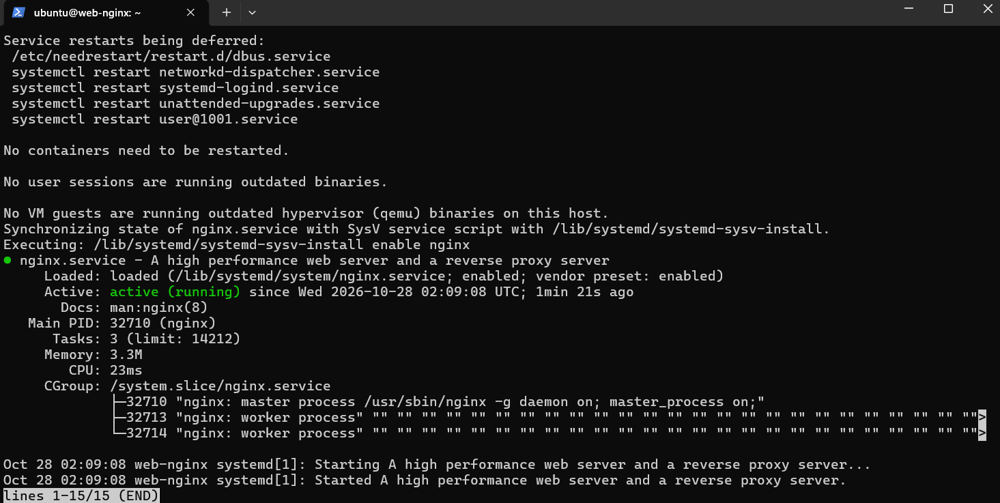

### Abrir el firewall interno de Ubuntu

Las imágenes de Oracle traen una regla `REJECT all` en `iptables`. Las reglas nuevas deben quedar **antes** de ella, de lo contrario no se aplican y el sitio no carga (error `ERR_CONNECTION_TIMED_OUT`).

1. Ver el orden actual:

```bash
sudo iptables -L INPUT -n --line-numbers
```

En esta VM la regla `REJECT` estaba en la posición **5**, así que las reglas nuevas se insertan en esa posición:

```bash
sudo iptables -I INPUT 5 -m state --state NEW -p tcp --dport 80 -j ACCEPT
sudo iptables -I INPUT 5 -m state --state NEW -p tcp --dport 443 -j ACCEPT
sudo netfilter-persistent save
```

2. Comprobar que el `REJECT all` quedó al final:

```bash
sudo iptables -L INPUT -n --line-numbers
```

> Si las reglas se insertaron después del `REJECT`, se eliminan con `sudo iptables -D INPUT <número>` y se vuelven a insertar en la posición correcta.

> Si `netfilter-persistent` no existe: `sudo apt install iptables-persistent -y` y repetir el último comando.

### Verificación

Abrir `http://147.15.48.201` en el navegador. Debe aparecer la página "Welcome to nginx!".

📸 **Captura 7:** página de bienvenida de Nginx.

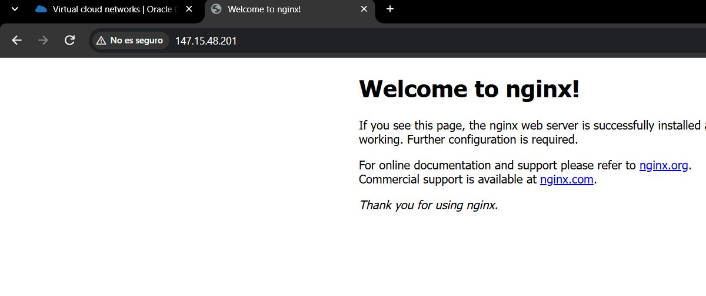

---

## Paso 6. Publicar la página web propia

### 6.1 Crear la carpeta del sitio

```bash
sudo mkdir -p /var/www/mipagina
sudo chown -R ubuntu:ubuntu /var/www/mipagina
```

### 6.2 Copiar la página desde el PC

La página es un único archivo (`indexx.html`, con el CSS y el JavaScript incluidos). Nginx busca `index.html`, así que se renombra al subirlo. Desde PowerShell en el equipo local (no en la VM), en la carpeta de la llave:

```powershell
scp -i .\ssh-key-2026-10-28.key "C:\Users\Usuario-PC\Downloads\indexx.html" ubuntu@147.15.48.201:/var/www/mipagina/index.html
```

Verificar en la VM:

```bash
ls -l /var/www/mipagina
```

📸 **Captura 8:** archivos copiados (`ls /var/www/mipagina` en la VM).

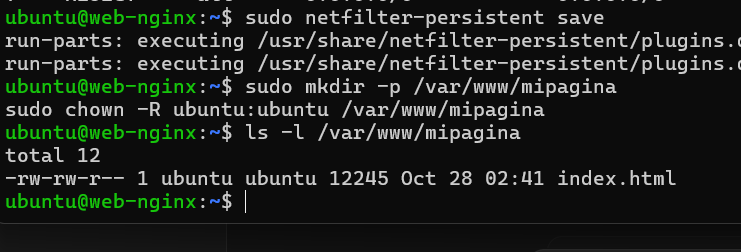

### 6.3 Crear la configuración del sitio

Se crea el archivo con `tee` para evitar errores al editar. Por ahora `server_name` queda como `_` y se cambia por el subdominio en el Paso 7.

Contenido:

```bash
sudo tee /etc/nginx/sites-available/mipagina > /dev/null <<'EOF'
server {
    listen 80;
    listen [::]:80;
    server_name _;

    root /var/www/mipagina;
    index index.html;

    location / {
        try_files $uri $uri/ =404;
    }
}
EOF
```

### 6.4 Activar el sitio

```bash
sudo ln -s /etc/nginx/sites-available/mipagina /etc/nginx/sites-enabled/
sudo rm /etc/nginx/sites-enabled/default
sudo nginx -t
sudo systemctl reload nginx
```

📸 **Captura 9:** resultado de `sudo nginx -t` (*syntax is ok*).

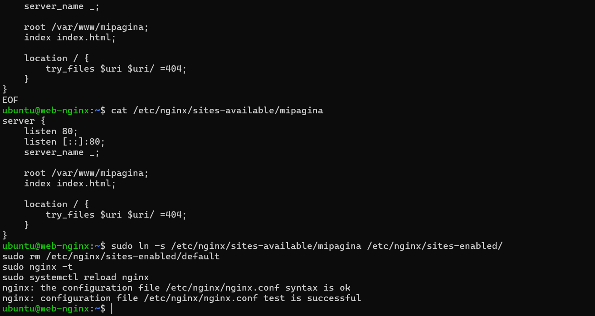

### 6.5 Verificación

Abrir `http://147.15.48.201` y comprobar que se muestra la página propia.

📸 **Captura 10:** página propia cargando por IP.

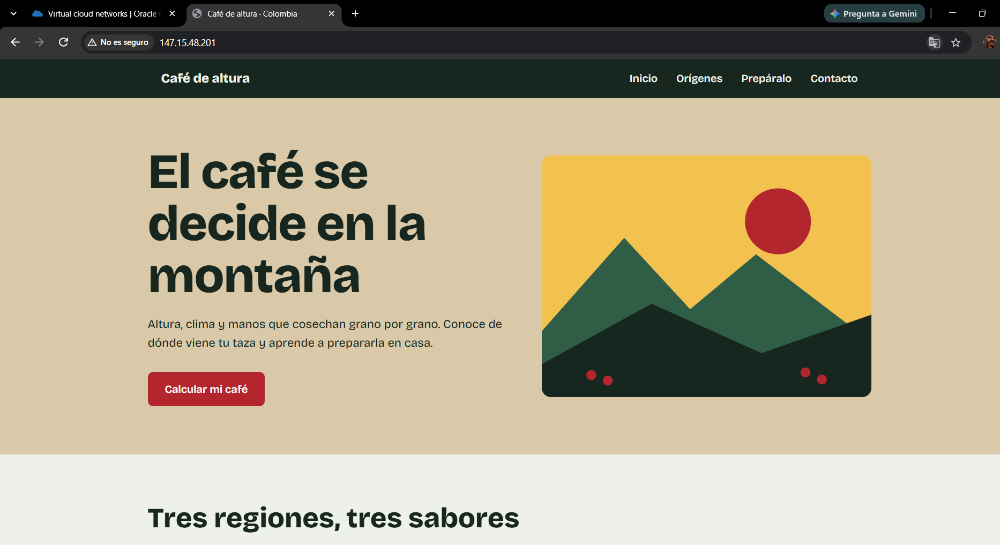

---

## Paso 7. Configurar el subdominio en DuckDNS

1. Entrar a [duckdns.org](https://www.duckdns.org) e iniciar sesión.
2. En la sección **domains**:

| Campo | Valor |
|-------|-------|
| sub domain | Un nombre propio, en minúsculas y sin espacios (ej. `tunombre-nginx`) |

Pulsar **add domain**.

3. En la fila del dominio creado:

| Campo | Valor |
|-------|-------|
| current ip | La IP pública de la VM |
| ipv6 | *(vacío)* |

Pulsar **update ip**.

📸 **Captura 11:** panel de DuckDNS con el dominio apuntando a la IP de la VM (ocultar el token).

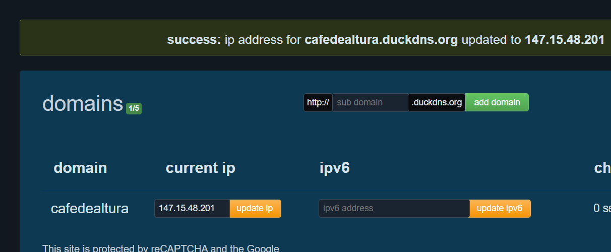

### 7.1 Usar el subdominio en Nginx

```bash
sudo sed -i 's/server_name _;/server_name cafedealtura.duckdns.org;/' /etc/nginx/sites-available/mipagina
grep server_name /etc/nginx/sites-available/mipagina
sudo nginx -t
sudo systemctl reload nginx
```

Comprobar que el dominio resuelve a la IP de la VM:

```bash
nslookup cafedealtura.duckdns.org
```

### 7.2 Actualización automática de la IP (opcional)

```bash
mkdir ~/duckdns && cd ~/duckdns
nano duck.sh
```

Contenido (reemplazar dominio y token):

```bash
echo url="https://www.duckdns.org/update?domains=cafedealtura&token=TU_TOKEN&ip=" | curl -k -o ~/duckdns/duck.log -K -
```

```bash
chmod 700 duck.sh
crontab -e
```

Agregar al final:

```
*/5 * * * * ~/duckdns/duck.sh >/dev/null 2>&1
```

> ⚠️ **No publiques tu token de DuckDNS** en capturas ni en este documento.

---

## Paso 8. Verificación desde un navegador externo

Desde un dispositivo fuera de la VM (el PC o un celular con datos móviles), abrir la dirección escribiendo **`http://`** al inicio (el sitio no usa HTTPS):

```
http://cafedealtura.duckdns.org
```

📸 **Captura 12:** sitio cargando con el subdominio desde un dispositivo externo.

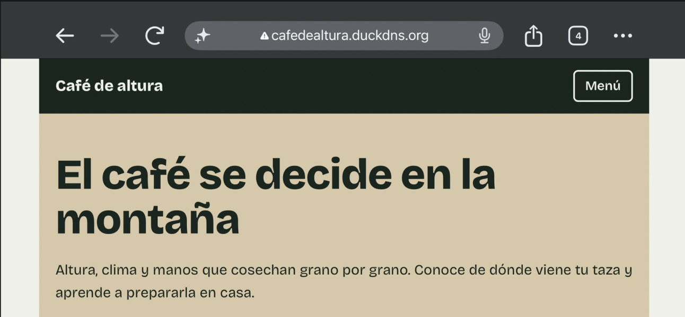

📸 **Captura 13 (opcional):** vista móvil mostrando el diseño adaptable.

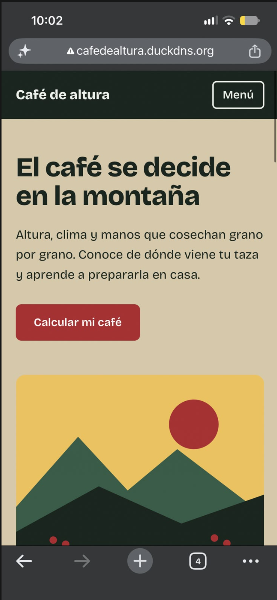

---

## Resultado final

- **Sitio web:** http://cafedealtura.duckdns.org
- **Servidor:** Ubuntu 22.04 en Oracle Cloud (Always Free)
- **Servicios:** Nginx publicando una página con HTML, CSS responsive y JavaScript.

## Solución de problemas

| Problema | Posible causa | Solución |
|----------|---------------|----------|
| La página no carga por IP (`ERR_CONNECTION_TIMED_OUT`) | Puerto 80 cerrado o regla después del `REJECT` | Revisar la Security List y que las reglas de `iptables` estén antes del `REJECT all` |
| `Could not resolve hostname` al usar `ssh` | Espacio entre `.\` y el nombre de la llave | Escribir `.\ssh-key-2026-10-28.key` sin espacios |
| El celular no abre el subdominio | El navegador cambia a HTTPS | Escribir `http://` o usar una pestaña de incógnito |
| `Permission denied` al copiar con `scp` | Permisos de la carpeta | `sudo chown -R ubuntu:ubuntu /var/www/mipagina` |
| `nginx -t` da error | Error de sintaxis en la config | Revisar llaves `{}` y `;` en el archivo |
| El subdominio no abre | IP desactualizada en DuckDNS | Actualizar la IP en el panel de DuckDNS |
| 404 en el sitio | Falta `index.html` en la carpeta | Verificar con `ls /var/www/mipagina` |
